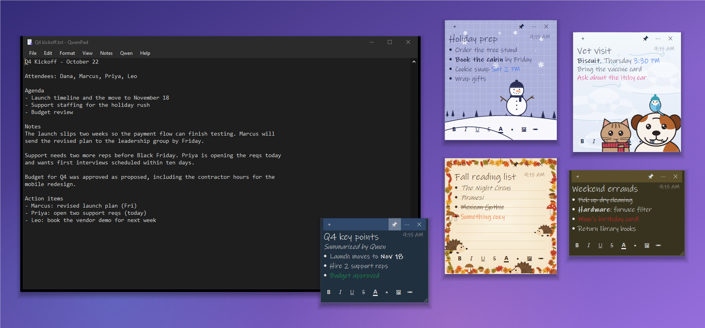
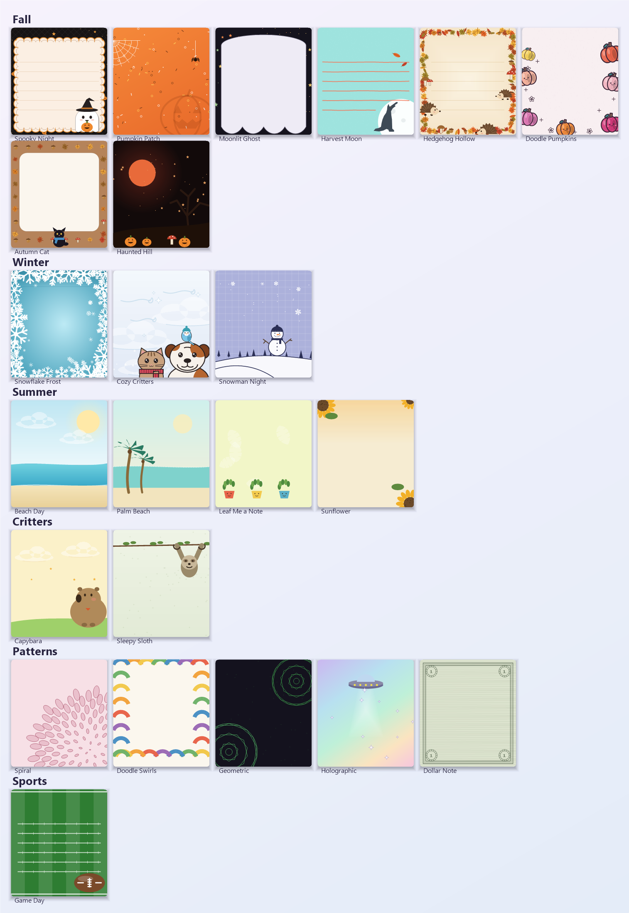
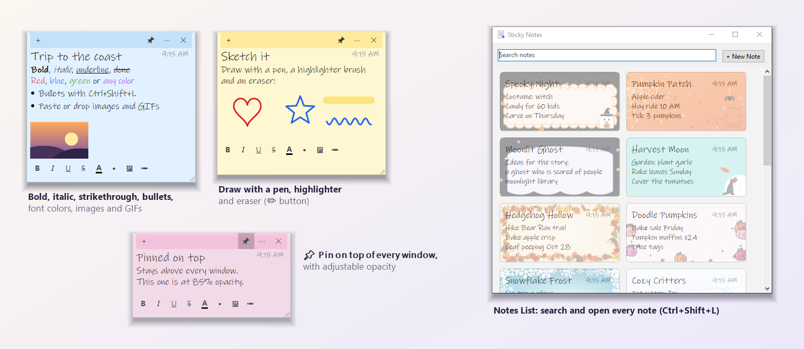

<div align="center">


# QwenPad

**Beautiful desktop sticky notes and a tiny Notepad for Windows, with a private AI that runs on your own PC.**
Jot it down, make it pretty, pin it on top, and let Qwen3.5 tidy it up, 100% offline. No cloud, no account, no telemetry.

[](https://github.com/248Tech/QwenPad/releases/latest)




</div>

## Why QwenPad?

Windows Sticky Notes is plain. Notepad is dumb. Cloud AI editors read everything you type. **QwenPad gives you gorgeous sticky notes and a fast editor with an AI that never leaves your machine.**

- 🗒️ **Sticky notes you'll actually enjoy.** 29 looks, from six classic colors to 23 hand-illustrated themes across six categories. Rich text, font colors, bullets, images, GIFs and freehand drawing.
- 📌 **Always where you need them.** Pin notes above every window, make them see-through, and keep them on screen even after you close QwenPad. They can even reopen when Windows starts.
- ✦ **AI in every note.** Press Ctrl+K in a note to have Qwen rewrite it, add to it or turn it into a checklist. Untitled notes get a title automatically, and an email becomes a stack of task notes.
- 🛟 **Notes don't get lost.** Crash-safe saves, a 30-day trash, automatic backups and one-click import from other copies.
- 🔒 **Private by design.** The AI runs locally through [llama.cpp](https://github.com/ggml-org/llama.cpp). Nothing is uploaded, ever. It works on a plane.
- ⚡ **Tiny, instant and portable.** A native ~230 KB app with no Electron and no installer. Unzip it anywhere, even a USB stick.

## 🗒️ Sticky notes that stay on your desktop



### Make them yours
- **23 hand-illustrated designs**, grouped by category in the ⋯ > 🎨 Themes menu, each with its own artwork, ink colors and ruled lines:
  - 🍂 **Fall:** Spooky Night · Pumpkin Patch · Moonlit Ghost · Harvest Moon · Hedgehog Hollow · Doodle Pumpkins · Autumn Cat · Haunted Hill
  - ❄ **Winter:** Snowflake Frost · Cozy Critters · Snowman Night
  - 🏖 **Summer:** Beach Day · Palm Beach · Leaf Me a Note · Sunflower
  - 🐾 **Critters:** Capybara · Sleepy Sloth
  - 🌀 **Patterns:** Spiral · Doodle Swirls · Geometric · Holographic · Dollar Note
  - 🏈 **Sports:** Game Day
- **Six classic colors** (yellow, green, pink, purple, blue, gray) that switch to matching dark versions in dark mode.
- **Background Art** (⋯ menu): fade a theme's artwork from full down to a faint watermark over plain paper, so the design never gets in the way of your words.
- A **handwritten font**, a **title**, and a **date** on every note (hover for the created and edited times).
- Every design is drawn in code, so it's sharp at any size and never covers your words with clutter.



### Write anything
- **Rich text:** bold, italic, underline, strikethrough and bullets, right from the format bar or the keyboard.
- **Font colors:** the **A** button offers Automatic, nine colors and a full color picker. Your colors stay put when you change the theme or the design.
- **Images and animated GIFs:** paste, drag in, or add them with 🖼. Drag an image's corner to resize it, or right-click > Size.
- **✏ Freehand drawing:** a pen, a see-through highlighter brush and an eraser, in five colors and three sizes, with undo.
- Notes **grow to fit** your text, and you can resize them from any edge.

### Keep them in view
- **📌 Pin a note on top of every window**, or all of them at once (Notes > Pin All Notes on Top).
- **Opacity** from 100% down to 30%, so a pinned note never hides what's behind it.
- **Layers:** Bring to Front, Send to Back, or **Ctrl+scroll** over a note to move it up and down the stack.
- Every note is a **real window** with its own taskbar button (Alt+Tab, minimize, restore).
- **Notes stay open when you close QwenPad.** The editor closes, your notes stay on screen, and QwenPad waits in the tray with the AI model unloaded. Launch QwenPad again and the editor comes right back.
- **Open Notes When Windows Starts** puts your notes back on the desktop every time you sign in (Notes menu or tray icon).

### Let Qwen help
- **Ctrl+K in a note:** ask Qwen to rewrite the selection or write at the cursor ("make this a checklist", "translate to Spanish", "add three ideas").
- **Auto-titles:** start typing in an untitled note and Qwen names it for you.
- **✦ Summarize to Note:** condense your document into a titled checklist note.
- **✦ Tasks From Email:** paste an email into QwenPad and get one task note per action item.
- **Note from Selection** and **Send to Sticky Note** (right-click) turn any text into a note, and **Insert into Document** sends a note back.

### Find and organize
- The **☰ Notes List** (Ctrl+Shift+L) shows every note as a card in its own design, with live search, keyboard navigation, pin and delete.
- **Show All Notes**, **Hide All Notes**, and a quick list of notes right in the Notes menu.
- Hiding a note (✕ or Ctrl+W) never deletes it. Bring it back from the Notes List.

### Never lose a note
- **Crash-safe saving:** every change is saved within a second, written to a temp file and swapped in, and the previous version is kept as a `.bak`.
- **Trash:** deleted notes are kept for 30 days. Use **Notes > Restore Deleted Notes**.
- **Automatic backups** of your notes every day and on every update, with the newest 15 kept in `backups\`.
- **Import Notes** from another QwenPad folder (like an older portable copy) or from any backup.
- Notes are plain files in `notes\` (a header plus RTF), so they're easy to back up, sync or read with anything.

### Sticky note shortcuts

| Keys | In a sticky note |
|---|---|
| **Ctrl+N** | New note (keeps this note's design, opacity and pin, and opens beside it) |
| **Ctrl+K** | Ask Qwen to rewrite the selection or write at the cursor |
| **Ctrl+B / I / U / T** | Bold / italic / underline / strikethrough |
| **Ctrl+Shift+L** | Bullets |
| **Ctrl+V** | Paste text or an image |
| **Ctrl+P** | Pin on top of all windows (or unpin) |
| **Ctrl+W** | Hide the note (it stays saved) |
| **Ctrl+D** | Delete (to the trash) |
| **Ctrl+scroll** | Move the note forward or back in the stack |
| **Menu key / Shift+F10** | Open the note's ⋯ menu |
| **Esc** | Stop Qwen while it writes |
| **P / B / E** | In draw mode: pen / brush / eraser |
| **Ctrl+Z**, **Esc** | In draw mode: undo a stroke, finish drawing |

## Download

1. Grab **`QwenPad-vX.Y.Z-win-x64.zip`** from the [latest release](https://github.com/248Tech/QwenPad/releases/latest) (~650 MB, includes the llama.cpp runtime).
2. Unzip anywhere and run **`QwenPad.exe`**.
3. On first launch, pick a model to download (one time, from Hugging Face). Every file is verified with SHA-256:


| Model | Size | Best for |
|---|---|---|
| **Qwen3.5 9B** *(recommended)* | 5.3 GB | Best quality. ~8 GB free RAM. |
| **Qwen3.5 4B** | 2.6 GB | Faster; PCs with 8 GB RAM or no GPU. |
| **Qwen3.5 9B Abliterated** | 5.2 GB | Community variant with refusal behavior removed. |

Already have a `.gguf` model? Drop it into the `models\` folder and pick it from **Qwen > Model**. The sticky notes work without any model at all.

> **Requirements:** Windows 10 or 11 (64-bit). An NVIDIA GPU (CUDA 12) speeds things up but isn't required: llama.cpp falls back to the CPU.
> On a GTX 1650 (4 GB), the 9B model generates about 5–6 tokens/s and the 4B about 10 tokens/s.

## ✦ AI writing assistant


| Shortcut | Action |
|---|---|
| **Ctrl+K** | **Ask Qwen anything.** Transform the selection, or write at the cursor using the document as context. |
| **Ctrl+Enter** | Continue writing from the cursor. |
| **Ctrl+Shift+I** | Improve writing. |
| **Ctrl+Shift+G** | Fix spelling & grammar. |
| Qwen > Rewrite | Shorter · Longer · Professional · Casual · Friendly · Translate To… |
| Qwen > Summarize / Key Points | Inserted below the text. |
| **Esc** | Stop generating (keeps what's written so far). |

With nothing selected, rewrite actions apply to the whole document. Results stream in live, and every AI edit is a **single undo step**.

## 📝 Everything you expect from Notepad
New/Open/Save/Save As/Print · Find/Replace (match case, wrap, up/down) · Go To line · Word wrap · Font · Zoom (Ctrl+Plus/Minus/0, Ctrl+wheel) · Status bar (Ln/Col, zoom, line endings, encoding) · Time/Date (F5) · Drag-and-drop · Ctrl+Backspace word delete. It detects and preserves **UTF-8, UTF-8 BOM, UTF-16 and ANSI** encodings and **CRLF/LF/CR** line endings.

**View > Theme:** Use System Setting (default, switches live), Light, or Dark. It covers the title bar, menus, scrollbars, dialogs and note colors.


## 📖 Complete command reference

<details>
<summary><b>File</b></summary>

| Command | Shortcut |
|---|---|
| New | Ctrl+N |
| New Window | Ctrl+Shift+N |
| Open… | Ctrl+O |
| Save | Ctrl+S |
| Save As… | Ctrl+Shift+S |
| Print… | Ctrl+P |
| Exit | Alt+F4 (with notes on screen, they stay open and QwenPad goes to the tray) |
</details>

<details>
<summary><b>Edit</b></summary>

| Command | Shortcut |
|---|---|
| Undo · Cut · Copy · Paste · Delete | Ctrl+Z · Ctrl+X · Ctrl+C · Ctrl+V · Del |
| Find… | Ctrl+F |
| Find Next / Find Previous | F3 / Shift+F3 |
| Replace… | Ctrl+H |
| Go To… | Ctrl+G |
| Select All | Ctrl+A |
| Time/Date | F5 |
| Right-click > Send to Sticky Note | Turns the selection into a note |
</details>

<details>
<summary><b>Format and View</b></summary>

| Command | Shortcut |
|---|---|
| Format > Word Wrap | |
| Format > Font… | |
| View > Zoom In / Zoom Out / Restore Default Zoom | Ctrl+Plus / Ctrl+Minus / Ctrl+0 (or Ctrl+wheel) |
| View > Status Bar | |
| View > Theme > Use System Setting / Light / Dark | |
</details>

<details>
<summary><b>Notes</b></summary>

| Command | Shortcut / notes |
|---|---|
| New Sticky Note | Ctrl+Shift+M |
| Note from Selection | Makes a note from the selected text |
| ✦ Summarize to Note | Qwen condenses the selection or document into a titled checklist note |
| Show All Notes / Hide All Notes | |
| 📌 Pin All Notes on Top / Unpin All Notes | |
| ☰ Notes List… | Ctrl+Shift+L |
| Clickable Images | Off by default; when on, clicking a note's image opens it |
| Keep Notes Open When QwenPad Closes | On by default |
| Open Notes When Windows Starts | Reopens your notes (without the editor or model) at sign-in |
| Restore Deleted Notes… | Brings back notes deleted in the last 30 days |
| Import Notes… | From another QwenPad folder or a backup |
| Open Notes Backups Folder | |
| *(your notes)* | Click one to show it or bring it to the front |
</details>

<details>
<summary><b>Qwen</b></summary>

| Command | Shortcut |
|---|---|
| Ask Qwen… | Ctrl+K |
| Continue Writing | Ctrl+Enter |
| Rewrite > Improve Writing | Ctrl+Shift+I |
| Rewrite > Fix Spelling & Grammar | Ctrl+Shift+G |
| Rewrite > Make Shorter · Make Longer · Professional · Casual · Friendly Tone · Translate To… | |
| Summarize · Key Points | |
| ✦ Tasks From Email | Paste an email, get one task note per action item |
| Stop Generating | Esc |
| Start / Stop Local Model | |
| Model > *(your models)* · Download a Model… · Browse for a .gguf… | |
| Show Server Log · Settings… | |
</details>

<details>
<summary><b>A sticky note's ⋯ menu and buttons</b></summary>

| Item | What it does |
|---|---|
| **+** button | New note (Ctrl+N) |
| **📌** button | Pin on top (Ctrl+P) |
| **✕** button | Hide (Ctrl+W) |
| Yellow · Green · Pink · Purple · Blue · Gray | Classic colors |
| 🎨 Themes ▸ | The 23 designs, grouped: Fall · Winter · Summer · Critters · Patterns · Sports |
| ✦ Ask Qwen… | Ctrl+K |
| Add Image or GIF… | Also paste or drag and drop |
| ✏ Draw | Pen, brush, eraser, five colors, three sizes, undo, clear |
| Pin on Top of All Windows | Ctrl+P |
| Opacity | 100% to 30% (the whole note) |
| Background Art | Full art down to a faint watermark (a design's artwork only) |
| Layer > Bring to Front · Move Forward · Move Back · Send to Back | Ctrl+scroll moves forward or back |
| ☰ Notes List… | |
| Insert into Document | Pastes the note into the editor |
| Delete Note | Ctrl+D (to the trash) |
| Format bar | **B** **I** **U** **S** **A** (font color) **•** (bullets) **🖼** (image) **✏** (draw) |
| Right-click an image | Open · Copy · Size (Small / Medium / Large / Full Width) · Remove from Note |
</details>

<details>
<summary><b>Notes List and tray icon</b></summary>

| Where | Keys / items |
|---|---|
| Notes List | Type to search · arrows to move · Enter to open · Delete to delete · Ctrl+N new note · Ctrl+F search · Esc close · right-click a card to Open, Show/Hide, Pin or Delete |
| Tray icon (while notes stay open) | Click to open QwenPad · Right-click: Open QwenPad · New Sticky Note · Notes List · Show All Notes · Open Notes When Windows Starts · Quit QwenPad |
</details>

<details>
<summary><b>Command line</b></summary>

| Command | What it does |
|---|---|
| `QwenPad.exe` | Opens the editor (or brings back a QwenPad that's waiting in the tray) |
| `QwenPad.exe file.txt` | Opens a file |
| `QwenPad.exe --notes` | Opens just your sticky notes, with QwenPad in the tray (what "Open Notes When Windows Starts" uses) |
</details>

## How it works

```
QwenPad.exe  ──HTTP (127.0.0.1 only)──▶  llama-server.exe  ──▶  your .gguf model
 (WinForms, .NET Framework 4)              (llama.cpp, CUDA/CPU)
```

QwenPad starts `llama-server` hidden in the background on launch (port 8765, localhost only) and stops it when you close the editor. It uses a Windows job object, so the model is unloaded even if the app crashes. Multiple QwenPad windows share one server. Qwen's "thinking" mode is disabled for snappy, answer-only output.

**Folder layout (portable):**
```
QwenPad.exe        the app
QwenPad.ini        settings (relative paths, so the folder can move)
runtime\llama\     llama.cpp server + CUDA runtime + VC++ runtime
models\            .gguf models (Qwen > Model lists them all)
notes\             sticky notes as .txt (notes\.trash = deleted, kept 30 days)
backups\           automatic copies of notes\ (daily and on each update)
logs\              model server log
```

## Configuration

**Qwen > Settings** (or `QwenPad.ini`) controls the server path, model, server arguments (default `-c 16384 --reasoning-budget 0`), URL, max tokens and temperature. QwenPad talks to any **OpenAI-compatible** `/v1/chat/completions` endpoint, so you can point it at an existing llama.cpp, LM Studio or Ollama server and turn off auto-start.

## Build from source

No SDK needed. It compiles with the C# compiler that ships with Windows.

```powershell
git clone https://github.com/248Tech/QwenPad.git
cd QwenPad
.\build.cmd                    # -> QwenPad.exe
.\tools\fetch-runtime.ps1      # downloads the pinned llama.cpp build into runtime\llama
.\package.ps1 -Release         # -> dist\QwenPad-v<ver>-win-x64.zip + SHA256SUMS.txt
```

Source layout: `src\MainForm.cs` (editor, AI actions, tray), `src\StickyNotes.cs` (notes and their storage), `src\NoteDesigns.cs` (the designs), `src\NotesList.cs`, `src\Sketch.cs` (drawing), `src\LlmClient.cs` (streaming client), `src\ServerManager.cs`, `src\ModelDownloader.cs`, `src\Theme.cs`, `src\Dialogs.cs`.

## FAQ

**Can I use the sticky notes without the AI?** Yes. Notes work fully without a model. The AI is there when you want it.

**Will my notes stay on screen after I close QwenPad?** Yes, by default. QwenPad waits in the tray with the model unloaded, and exits when you hide the last note or choose **Quit QwenPad** from the tray. Turn it off with **Notes > Keep Notes Open When QwenPad Closes**.

**How do I get my notes back after a restart?** Turn on **Notes > Open Notes When Windows Starts**, or just open QwenPad: notes always reopen where you left them.

**I deleted a note by mistake.** Use **Notes > Restore Deleted Notes**. Deleted notes are kept for 30 days, and `backups\` has daily copies too.

**Is it really offline?** Yes. After the one-time model download, QwenPad makes no network requests other than to `127.0.0.1`. You can block it in your firewall and everything still works.

**Does it work without an NVIDIA GPU?** Yes, on the CPU. Pick the 4B model for the best speed.

**Can I use a different model?** Any chat-capable GGUF that llama.cpp supports. Put it in `models\` and select it under **Qwen > Model**.

**Where is my data?** Your documents are wherever you save them. Notes, backups and settings live in the QwenPad folder. Nothing is stored elsewhere, except an optional startup entry if you turn on Open Notes When Windows Starts.

## License

QwenPad is released under the [MIT License](LICENSE). Bundled and downloaded components keep their own licenses. See [THIRD-PARTY-NOTICES.md](THIRD-PARTY-NOTICES.md). Qwen models are © Alibaba Cloud and licensed Apache-2.0. QwenPad is an independent project and is not affiliated with Alibaba, Qwen or Microsoft.

<div align="center">

**If QwenPad's sticky notes make your desktop nicer, please ⭐ star the repo. It helps others find it.**

</div>
