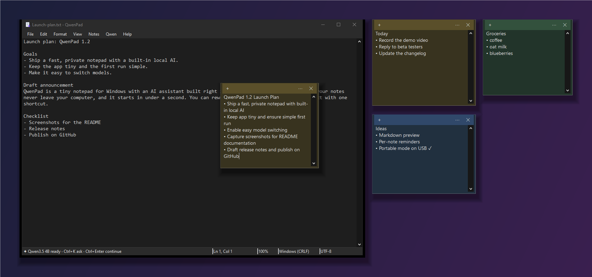
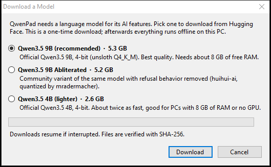
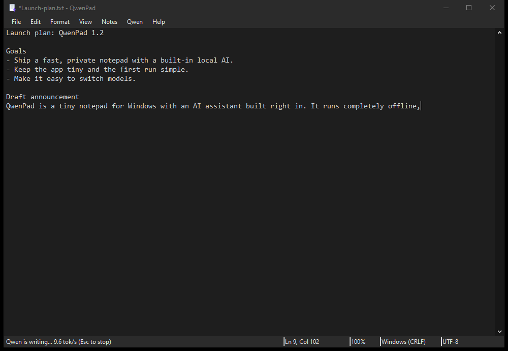
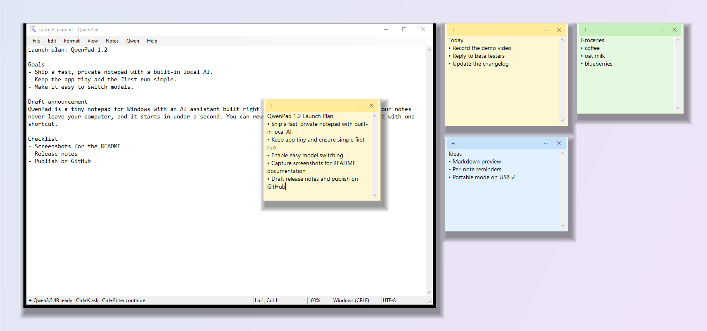

<div align="center">


# QwenPad

**A tiny, private Notepad for Windows with a local AI writing assistant built in.**
Rewrite, fix, summarize and continue text with Qwen3.5, running 100% offline on your own PC. No cloud, no account, no telemetry.

[](https://github.com/248Tech/QwenPad/releases/latest)




</div>

## Why QwenPad?

Windows Notepad is fast but dumb. Cloud AI editors are smart but send everything you type to someone else's server. **QwenPad is both fast and smart, and your text never leaves your machine.**

- ⚡ **Instant and lightweight.** A ~100 KB native app that opens in well under a second. No Electron, no installer.
- 🔒 **Private by design.** The AI runs locally through [llama.cpp](https://github.com/ggml-org/llama.cpp). Nothing is uploaded, ever. It works on a plane.
- ✦ **AI where you type.** Rewrite, fix grammar, change tone, translate, summarize or continue text with one shortcut. Results stream in live and undo with a single Ctrl+Z.
- 🗒️ **Sticky notes.** Desktop sticky notes with the same AI built in, saved as plain text.
- 🌙 **Dark mode.** Follows Windows automatically, or pick Light/Dark.
- 🎒 **Portable.** Unzip and run from any folder or USB stick. Settings and notes stay inside the folder.

## Download

1. Grab **`QwenPad-vX.Y.Z-win-x64.zip`** from the [latest release](https://github.com/248Tech/QwenPad/releases/latest) (~650 MB, includes the llama.cpp runtime).
2. Unzip anywhere and run **`QwenPad.exe`**.
3. On first launch, pick a model to download (one time, from Hugging Face). Every file is verified with SHA-256:



| Model | Size | Best for |
|---|---|---|
| **Qwen3.5 9B** *(recommended)* | 5.3 GB | Best quality. ~8 GB free RAM. |
| **Qwen3.5 4B** | 2.6 GB | Faster; PCs with 8 GB RAM or no GPU. |
| **Qwen3.5 9B Abliterated** | 5.2 GB | Community variant with refusal behavior removed. |

Already have a `.gguf` model? Drop it into the `models\` folder and pick it from **Qwen > Model**.

> **Requirements:** Windows 10 or 11 (64-bit). An NVIDIA GPU (CUDA 12) speeds things up but isn't required: llama.cpp falls back to the CPU.
> On a GTX 1650 (4 GB), the 9B model generates about 5–6 tokens/s and the 4B about 10 tokens/s.

## Features

### ✦ AI writing assistant


| Shortcut | Action |
|---|---|
| **Ctrl+K** | **Ask Qwen anything.** Transform the selection, or write at the cursor using the document as context. |
| **Ctrl+Enter** | Continue writing from the cursor. |
| **Ctrl+Shift+I** | Improve writing. |
| **Ctrl+Shift+G** | Fix spelling & grammar. |
| Qwen > Rewrite | Shorter · Longer · Professional · Casual · Friendly · Translate |
| Qwen > Summarize / Key Points | Inserted below the text. |
| **Esc** | Stop generating (keeps what's written so far). |

With nothing selected, rewrite actions apply to the whole document. Every AI edit is a **single undo step**.

### 🗒️ Sticky notes
- **Notes > New Sticky Note** (Ctrl+Shift+M), **Note from Selection**, or **✦ Summarize to Note**, where Qwen condenses your document into a titled checklist.
- **Ctrl+K inside a note** asks Qwen to rewrite or add to it.
- Each note is its own window with a taskbar button grouped under QwenPad (minimize, restore, Alt+Tab).
- Six colors, always-on-top, drag to move and resize, and **Insert into Document**.
- Saved automatically as plain `.txt` files in `notes\` and restored on the next launch.

### 📝 Everything you expect from Notepad
New/Open/Save/Save As/Print · Find/Replace (match case, wrap, up/down) · Go To line · Word wrap · Font · Zoom (Ctrl+Plus/Minus/0, Ctrl+wheel) · Status bar (Ln/Col, zoom, line endings, encoding) · Time/Date (F5) · Drag-and-drop · Ctrl+Backspace word delete. It detects and preserves **UTF-8, UTF-8 BOM, UTF-16 and ANSI** encodings and **CRLF/LF/CR** line endings.

### 🌙 Light and dark


**View > Theme:** Use System Setting (default, switches live), Light, or Dark. It covers the title bar, menus, scrollbars, dialogs and note colors.

## How it works

```
QwenPad.exe  ──HTTP (127.0.0.1 only)──▶  llama-server.exe  ──▶  your .gguf model
 (WinForms, .NET Framework 4)              (llama.cpp, CUDA/CPU)
```

QwenPad starts `llama-server` hidden in the background on launch (port 8765, localhost only) and stops it on exit. It uses a Windows job object, so the model is unloaded even if the app crashes. Multiple QwenPad windows share one server. Qwen's "thinking" mode is disabled for snappy, answer-only output.

**Folder layout (portable):**
```
QwenPad.exe        the app
QwenPad.ini        settings (relative paths, so the folder can move)
runtime\llama\     llama.cpp server + CUDA runtime + VC++ runtime
models\            .gguf models (Qwen > Model lists them all)
notes\             sticky notes as .txt
logs\              model server log
```

## Configuration

**Qwen > Settings** (or `QwenPad.ini`) controls the server path, model, server arguments (default `-c 16384 --reasoning-budget 0`), URL, max tokens and temperature. QwenPad talks to any **OpenAI-compatible** `/v1/chat/completions` endpoint, so you can point it at an existing llama.cpp, LM Studio or Ollama server and turn off auto-start.

## Build from source

No SDK needed. It compiles with the C# compiler that ships with Windows.

```powershell
git clone https://github.com/248Tech/QwenPad.git
cd QwenPad
.\build.cmd                    # -> QwenPad.exe
.\tools\fetch-runtime.ps1      # downloads the pinned llama.cpp build into runtime\llama
.\package.ps1 -Release         # -> dist\QwenPad-v<ver>-win-x64.zip + SHA256SUMS.txt
```

Source layout: `src\MainForm.cs` (editor and AI actions), `src\StickyNotes.cs`, `src\LlmClient.cs` (streaming client), `src\ServerManager.cs`, `src\ModelDownloader.cs`, `src\Theme.cs`, `src\Dialogs.cs`.

## FAQ

**Is it really offline?** Yes. After the one-time model download, QwenPad makes no network requests other than to `127.0.0.1`. You can block it in your firewall and everything still works.

**Does it work without an NVIDIA GPU?** Yes, on the CPU. Pick the 4B model for the best speed.

**Can I use a different model?** Any chat-capable GGUF that llama.cpp supports. Put it in `models\` and select it under **Qwen > Model**.

**Where is my data?** Your documents are wherever you save them. Notes and settings live in the QwenPad folder. Nothing is stored elsewhere.

## License

QwenPad is released under the [MIT License](LICENSE). Bundled and downloaded components keep their own licenses. See [THIRD-PARTY-NOTICES.md](THIRD-PARTY-NOTICES.md). Qwen models are © Alibaba Cloud and licensed Apache-2.0. QwenPad is an independent project and is not affiliated with Alibaba, Qwen or Microsoft.

<div align="center">

**If QwenPad is useful to you, please ⭐ star the repo. It helps others find it.**

</div>
